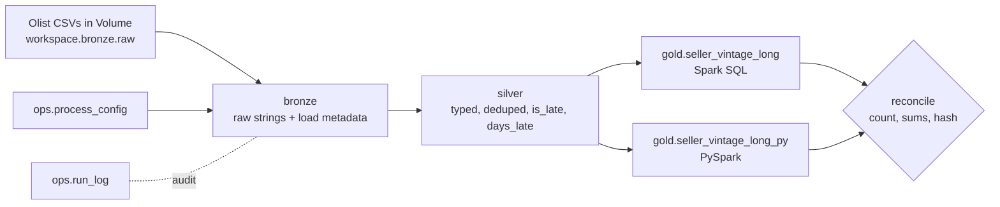

This is a project that rebuilds a **vintage (cosecha) delinquency pipeline** on public data, running the same logic as Spark SQL and as PySpark, locally and on Databricks. It follows the bronze/silver/gold (medallion) pattern, uses a parameter table and an audit log, and is deployed from the terminal with a Databricks Asset Bundle.

The data is the public Olist Brazilian e-commerce dataset.

## Business analogy

| Bank concept | Olist analog |
|---|---|
| Loan | Order item |
| Disbursement month (cohort) | Seller's first delivered-order month |
| Months on book (0..N) | Months since the seller's first sale (0..24) |
| Deteriorated balance | Order value delivered late (`delivered > estimated`) |

## Architecture



## Repo layout

```
databricks.yml            Bundle: name, variables, dev target
resources/job.yml         Job: parameters, serverless environment (wheel), notebook task
pyproject.toml            Package metadata (wheel build) and pytest config
src/common/               spark_utils (names, session), config (process_config), audit (run_log + retry)
src/bronze/               CSV -> bronze tables
src/silver/               typing, dedup, is_late/days_late
src/gold/                 vintage_sql.sql, vintage_pyspark.py (SQL and PySpark implementations)
src/run_pipeline.py       Local entry point (argparse)
notebooks/01_run_pipeline.py   Databricks entry point (widgets)
notebooks/02_reconcile.py      Compares two gold tables by count, sums, hash
tests/                    pytest suites (gold logic, write_gold idempotency)
```

## Run it

### 1. Unit tests

```bash
pytest -q
```

### 2. Local pipeline (run from a scratch directory so `spark-warehouse/` and `metastore_db/` stay out of the repo)

```bash
mkdir -p /scratch/<area>/$USER/olist-run && cd /scratch/<area>/$USER/olist-run
export PYTHONPATH=/path/to/Azure-Databricks/projects/olist-vintage-lakehouse/src
python $PYTHONPATH/run_pipeline.py --fechaproceso 2018-08-31
python $PYTHONPATH/../notebooks/02_reconcile.py     # expect RECONCILED
```

Expected: `bronze.orders_raw: 99441 rows`, `order_items_raw: 112650`, `sellers_raw: 3095`, then `run_log written ... status=Correcto`. The `Total allocation exceeds 95% of heap` warnings come from local mode's default 1 GB driver heap while writing Parquet. They are harmless at this size.

### 3. Upload the data to a Volume

```bash
databricks schemas create bronze workspace
databricks volumes create workspace bronze raw MANAGED
D=/path/to/SQL-PySpark/datasets/EXTRACTED/brazilian-ecommerce
for f in olist_orders_dataset.csv olist_order_items_dataset.csv olist_sellers_dataset.csv; do
  databricks fs cp $D/$f dbfs:/Volumes/workspace/bronze/raw/
done
databricks fs ls dbfs:/Volumes/workspace/bronze/raw/
```

### 4. Build and upload the wheel

```bash
python -m build --wheel
databricks volumes create workspace bronze libs MANAGED
databricks fs cp dist/olist_vintage_lakehouse-<version>-py3-none-any.whl dbfs:/Volumes/workspace/bronze/libs/ --overwrite
```

Bump `version` in `pyproject.toml` and the filename in `resources/job.yml` whenever the code changes, so serverless does not reuse a cached environment.

### 5. Deploy and run on Databricks

```bash
databricks bundle validate -t dev
databricks bundle deploy -t dev
databricks bundle run -t dev olist_pipeline --params fechaproceso=2018-08-31
```

### 6. Query results from the terminal

```bash
databricks warehouses list
databricks api post /api/2.0/sql/statements --json '{
  "warehouse_id": "<WAREHOUSE_ID>",
  "statement": "SELECT count(*) n, sum(late_amount) late, sum(total_amount) total FROM workspace.gold.seller_vintage_long",
  "wait_timeout": "30s"
}' | grep -A8 data_array
```

## Results

| Check | Local (Parquet) | Databricks (Delta) |
|---|---|---|
| Gold rows (`seller_vintage_long`) | 235 | 235 |
| Late amount sum | 1,158,920.51 | 1,158,920.51 |
| Total amount sum | 13,220,248.93 | 13,220,248.93 |
| Row hash (`xxhash64` sum) | 101643891411089654003 | 101643891411089654003 |
| SQL vs PySpark gold | RECONCILED (same hash) | same rows and sums |
| `is_late` false / true / null | 88,649 / 7,827 / 2,965 | 88,649 / 7,827 / 2,965 |
| Rerun, same date | hash unchanged | rows stayed 235 |
| `run_log` | Rutina, Reproceso/Error, Reproceso/Correcto | Rutina, Reproceso |

The late share is about 8.8% of the total amount. The 2016-10 cohort jumps from mob 0 to mob 3. That is a real gap in the Olist data (almost no orders in late 2016), not a bug.

## Design decisions

- **Two implementations (Spark SQL and PySpark), one reconciliation.** Mirrors an Oracle-to-PySpark migration: compare row counts, sums and a row-level hash, not just totals.
- **`process_config` and `run_log`.** A parameter table and an audit log with retry and backoff, analogous to a batch framework's parameter and log tables. `run_log` labels reruns of the same date as `Reproceso`.
- **Same code, two environments.** When `CATALOG` is unset, tables are `schema.table` in a local Hive-backed warehouse. When set (`workspace`), they are Unity Catalog three-part names.
- **Gold partitioned by `cohort_month`, written by `insertInto` overwrite**, so a rerun replaces data instead of appending.
- **Wheel instead of workspace imports** (see problem 2 below).
- **Bundle instead of manual notebooks**, so deployment is repeatable from the terminal.

## Databricks vocabulary

| Term | Meaning |
|---|---|
| Workspace | Your Databricks environment (UI, notebooks, jobs), identified by its URL |
| Free Edition | Free tier: serverless only, with quotas, runs on AWS behind the scenes |
| Serverless compute | Databricks manages compute. You do not create or size a cluster |
| SQL warehouse | Compute for SQL queries (here, "Serverless Starter Warehouse") |
| Unity Catalog | Governance layer. Objects are addressed as `catalog.schema.object` |
| Catalog / Schema | Top-level container (`workspace`) and its sub-groups (`bronze`, `silver`, `gold`, `ops`) |
| Table | Structured data queried with SQL. Delta by default on Databricks |
| Delta Lake | Table format with transactions, `MERGE` and time travel |
| Volume | Governed storage for files (CSVs, wheels), as opposed to tables |
| Managed vs external | Managed: Databricks chooses the storage location. External: you do (for example ADLS) |
| Medallion architecture | Naming convention: bronze (raw), silver (clean), gold (business aggregates) |
| Notebook | Code document. Used here as the job entry point |
| Job / task | A run of one or more tasks (here one notebook task) |
| Job parameter / widget | Run-time value (`fechaproceso`), read with `dbutils.widgets` |
| Environment (serverless) | Python dependencies installed for a serverless task (used to install the wheel) |
| Asset Bundle (DAB) | Jobs, files and targets defined as YAML and deployed from the CLI |
| Target | A bundle deployment destination (`dev`, later `prod`) |
| Wheel (`.whl`) | Built Python package installed instead of importing workspace files |
| Personal access token (PAT) | Password-like credential for the CLI. It expires |
| `dbfs:/Volumes/...` | Path style the CLI uses for Volumes. In code it is `/Volumes/...` |
| `dbutils` | Databricks utility object (widgets, file system, secrets) |
| Lakeflow Jobs | Current name for Workflows (orchestration) |
| Auto Loader | Incremental file ingestion (not used yet, but on the associate exam) |

## Commands used

| Command | Meaning |
|---|---|
| `databricks configure --host <url>` | Stores workspace URL and token in the config file |
| `databricks current-user me` | Authentication test ("who am I?") |
| `databricks auth profiles` | Lists saved profiles and whether the token is valid |
| `databricks catalogs list` | Lists visible catalogs |
| `databricks schemas create <name> <catalog>` | Creates a schema |
| `databricks volumes create <catalog> <schema> <name> MANAGED` | Creates a managed volume |
| `databricks fs cp <src> <dst> [--overwrite]` | Copies a file to or from a Volume |
| `databricks fs ls dbfs:/Volumes/...` | Lists files in a Volume |
| `databricks warehouses list` | Lists SQL warehouses and their state |
| `databricks api post /api/2.0/sql/statements --json ...` | Runs a SQL statement through the REST API |
| `databricks workspace list` / `export` | Reads workspace files through the API |
| `databricks bundle validate -t dev` | Checks the bundle YAML |
| `databricks bundle deploy -t dev` | Uploads files and creates or updates the job |
| `databricks bundle run -t dev <job> --params k=v` | Runs the job and waits for the result |
| `databricks bundle destroy -t dev` | Deletes the deployed job and files |
| `python -m build --wheel` | Builds the wheel from `pyproject.toml` |
| `pytest -q` | Runs the unit tests |
| `apptainer shell --cleanenv --bind ... --env ...` | Opens the container with credential folders bound in |
| `az login --use-device-code --tenant <id>` | Azure login without a browser on the machine |
| `az account show` | Shows the active Azure subscription |