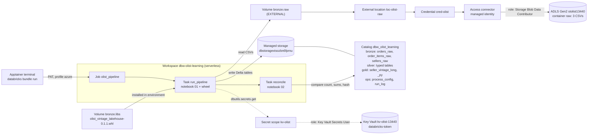
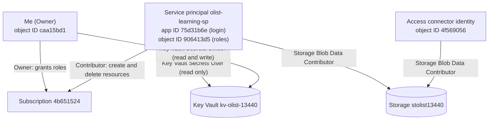
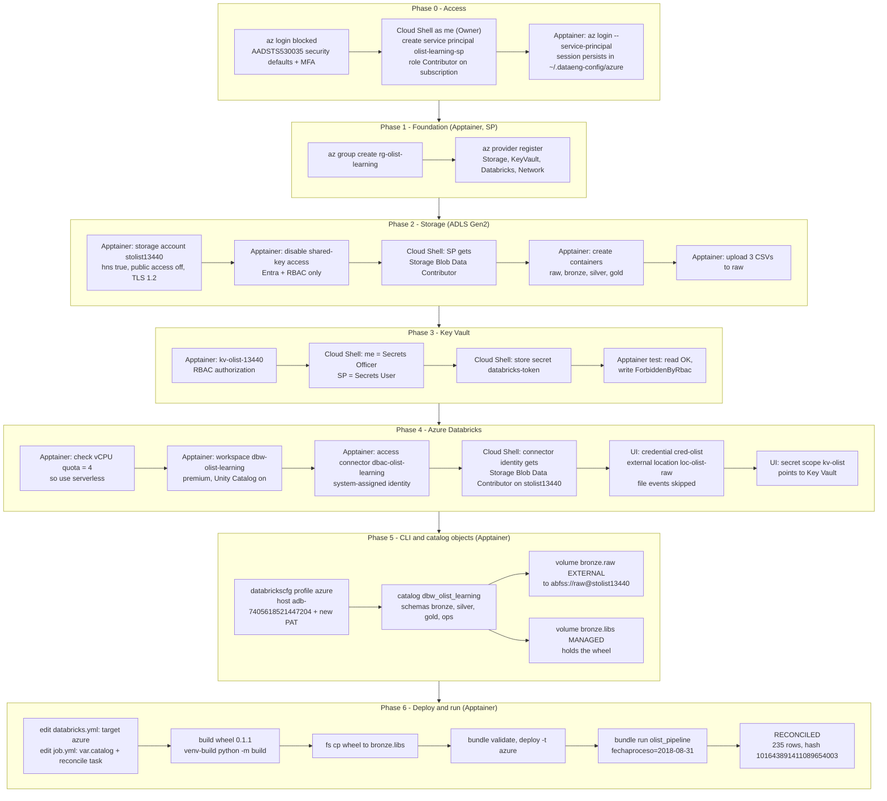

# Azure: infrastructure, deployment and run

This covers:
- Infrastructure (Azure CLI)
- The identity and permission model that connects the pieces
- Pipeline (bronze, silver, gold, reconcile) deployment on Azure Databricks (Databricks Asset Bundle).
The pipeline logic did not change. What changed is where the data lives, how identities authenticate, and how the code is deployed.

> Replace the `<PLACEHOLDER>` values with your own IDs. Subscription, tenant and object IDs are not secrets, but keep them out of public repos anyway. **Never commit passwords, service principal secrets or Databricks tokens (PATs).**

---

## 1. Goal

- Learn the Azure building blocks that a Databricks lakehouse depends on: resource groups, ADLS Gen2, RBAC, Key Vault, managed identities, Unity Catalog storage wiring.
- Run the same pipeline that already worked on Databricks Free Edition, now against data stored in an Azure storage account owned by this subscription.
- Prove equivalence: the Azure run must reproduce the Free Edition results exactly.

---

## 2. Architecture overview

How data and identities flow when the job runs (runtime):



Each arrow is an identity holding a role at a scope. The access connector reads and writes storage, Databricks reads Key Vault, the service principal manages resources, and the human owner administers everything, with no passwords in code.

---

## 3. Who runs what

Three places are used, and the split matters.

| Where | Runs as | Used for | Why |
|---|---|---|---|
| **Apptainer terminal on the HPC** | the service principal (SP) | Creating and using resources: storage, vault, workspace, uploads, bundle deploy and run | `az login` as a human was blocked by tenant security defaults (MFA), so the SP is the CLI identity |
| **Azure Cloud Shell** (portal) | me (subscription Owner) | Creating the SP and **granting roles** (`az role assignment create`) | The SP has Contributor, which cannot write role assignments |
| **Databricks workspace UI** | me (workspace admin) | Unity Catalog credential, external location, secret scope | These steps are done in the workspace (or account console), not with `az` |

Rule of thumb: **Apptainer (SP) creates and uses resources. Cloud Shell (me) creates identities and grants roles.**

---

## 4. Variables and names

Shell variables are stored in `~/.dataeng-config/olist.env` on the host (mode `600`, no secrets) and loaded inside the container with `source /cfg/olist.env`. The container is launched with `--cleanenv`, so host variables do not carry over; this file is the single source of truth.

| Variable | Example value | Meaning |
|---|---|---|
| `SUF` | `13440` | Random numeric suffix. Storage account and Key Vault names are globally unique |
| `SA` | `stolist13440` | **S**torage **A**ccount name (the data lake) |
| `RG` | `rg-olist-learning` | **R**esource **G**roup. Container for all resources; deleting it is the cleanup |
| `KV` | `kv-olist-13440` | **K**ey **V**ault name |
| `SP` | `<SP_APP_ID>` | **S**ervice **P**rincipal application (client) ID, its "username" for login |
| `SUB` | `<SUBSCRIPTION_ID>` | Subscription ID (billing and quota boundary) |
| `TENANT` | `<TENANT_ID>` | Microsoft Entra tenant (directory) ID |
| `D` | `.../brazilian-ecommerce` | Local folder that holds the Olist CSVs |
| `ME` | `<MY_USER_OBJECT_ID>` | My user's object ID (Cloud Shell only) |
| `KVID` | `/subscriptions/.../vaults/kv-olist-13440` | Full resource ID of the vault, used as a role-assignment scope (Cloud Shell only) |
| `SCOPE` | `/subscriptions/.../storageAccounts/stolist13440` | Full resource ID of the storage account, used as a role-assignment scope |
| `PRINCIPAL` | `<CONNECTOR_PRINCIPAL_ID>` | Object ID of the access connector's managed identity |
| `AZ_PW`, `PAT`, `NEWPAT` | (secret) | Temporary values read with `read -s` and unset immediately |

`~/.dataeng-config/olist.env`:

```bash
export SUF=13440
export SA=stolist13440
export RG=rg-olist-learning
export KV=kv-olist-13440
export SP=<SP_APP_ID>
export SUB=<SUBSCRIPTION_ID>
export TENANT=<TENANT_ID>
export D=/path/to/SQL-PySpark/datasets/EXTRACTED/brazilian-ecommerce
```

### Why one service principal has two IDs

| ID | Used for |
|---|---|
| **Application (client) ID** | Logging in: `az login --service-principal -u <appId>` |
| **Object ID** | Role assignments, file ownership in storage, the "Caller" field in authorization errors |

These are two names for the same identity. Mixing them up is the most common source of confusion. The Databricks CLI config holds two profiles:

| Profile | Workspace | Notes |
|---|---|---|
| `DEFAULT` | Free Edition (`dbc-...cloud.databricks.com`) | Default. Commands without `-p` go here |
| `azure` | Azure Databricks (`adb-<WORKSPACE_ID>.4.azuredatabricks.net`) | Always pass `-p azure` for the Azure workspace |

---

## 6. Resource inventory

All in resource group `rg-olist-learning`, region `eastus2`.

| Resource | Name | Purpose |
|---|---|---|
| Storage account (ADLS Gen2, HNS on) | `stolist13440` | Data lake. Containers: `raw` (3 CSVs), `bronze`, `silver`, `gold` (the last three are empty and unused) |
| Key Vault (RBAC authorization) | `kv-olist-13440` | Holds secret `databricks-token` |
| Azure Databricks workspace (premium) | `dbw-olist-learning` | Compute, notebooks, Unity Catalog |
| Access connector (system-assigned identity) | `dbac-olist-learning` | The identity Databricks uses to reach storage |
| Managed resource group (auto-created) | `databricks-rg-dbw-olist-learning-...` | Databricks internals. Do not modify |
| Managed storage account (auto-created) | `dbstorage...` | Stores the managed Delta tables and the managed `libs` volume |

### Unity Catalog layout (metadata inside the workspace)

```
metastore_azure_eastus2
└─ catalog dbw_olist_learning              (managed storage: workspace's dbstorage account)
   ├─ schema bronze
   │   ├─ tables: orders_raw, order_items_raw, sellers_raw
   │   ├─ volume raw   (EXTERNAL) -> abfss://raw@stolist13440.dfs.core.windows.net/
   │   └─ volume libs  (MANAGED)  -> holds the wheel
   ├─ schema silver  -> typed, deduplicated tables
   ├─ schema gold    -> seller_vintage_long (SQL), seller_vintage_long_py (PySpark)
   └─ schema ops     -> process_config, run_log
```

Other Unity Catalog objects: credential `cred-olist` (wraps the access connector), external location `loc-olist-raw`, secret scope `kv-olist` (backed by the vault).

**Where the data actually lives:** only the raw CSVs live in `stolist13440`. The bronze, silver and gold **tables** live in the workspace's managed storage. The empty `bronze`, `silver` and `gold` containers in `stolist13440` are unused.

Paths used by the code:

| Path | Content |
|---|---|
| `/Volumes/dbw_olist_learning/bronze/raw/` | Input CSVs (external volume over ADLS) |
| `/Volumes/dbw_olist_learning/bronze/libs/olist_vintage_lakehouse-0.1.1-py3-none-any.whl` | The project wheel |

---

## 7. Identities and permissions



| Identity | Role | Scope | Allows |
|---|---|---|---|
| Me (user) | Owner | Subscription | Everything, including granting roles |
| Me (user) | Key Vault Secrets Officer | Key Vault | Read and write secrets |
| Service principal | Contributor | Subscription | Create and delete resources (control plane). Cannot grant roles |
| Service principal | Storage Blob Data Contributor | Storage account | Read and write data (data plane) |
| Service principal | Key Vault Secrets User | Key Vault | Read secrets only |
| Access connector identity | Storage Blob Data Contributor | Storage account | Databricks reads and writes the lake |

Key concept, **control plane vs data plane**: Contributor manages the *resources* (create a storage account, delete a vault) but has no rights over the *contents* (blobs, secrets). Data-plane roles are separate. Key Vault demonstrated this cleanly: the SP could read a secret but writing one failed with `ForbiddenByRbac`.

---

## 8. Setup workflow, step by step



Legend: **[A]** Apptainer as SP, **[C]** Cloud Shell as me, **[UI]** Databricks workspace.

### Phase 0: Access

The first `az group create` failed with `AADSTS530035` (blocked by security defaults), and the device-code login for a personal account also failed. The portal worked, so access was set up through Cloud Shell.

**[C]** Create the service principal with Contributor on the subscription. The output (`appId`, `password`, `tenant`) is shown once:

```bash
az ad sp create-for-rbac -n olist-learning-sp \
  --role Contributor \
  --scopes /subscriptions/<SUBSCRIPTION_ID>
Creating 'Contributor' role assignment under scope '/subscriptions/<SUBSCRIPTION_ID>'
The output includes credentials that you must protect. Be sure that you do not include these credentials in your code or check the credentials into your source control. For more information, see https://aka.ms/azadsp-cli
{
  "appId": "<SP_APP_ID>",
  "displayName": "olist-learning-sp",
  "password": "<AZ_PW>",
  "tenant": "<TENANT_ID>"
}

```

**[A]** Log in as the SP. The session persists in the bound `~/.dataeng-config/azure`:

```bash
read -rsp "SP password: " AZ_PW; echo
az login --service-principal -u <SP_APP_ID> -p "$AZ_PW" --tenant <TENANT_ID>
unset AZ_PW
[
  {
    "cloudName": "AzureCloud",
    "homeTenantId": "<TENANT_ID>",
    "id": "<SUB>",
    "isDefault": true,
    "managedByTenants": [],
    "name": "Azure subscription 1",
    "state": "Enabled",
    "tenantId": "<TENANT_ID>",
    "user": {
      "name": "<SP_APP_ID>",
      "type": "servicePrincipal"
    }
  }
]

az account set --subscription <SUBSCRIPTION_ID>
az account show -o table
EnvironmentName    HomeTenantId                          IsDefault    Name                  State    TenantId
-----------------  ------------------------------------  -----------  --------------------  -------  ------------------------------------
AzureCloud         <TENANT_ID>                           True         Azure subscription 1  Enabled  <TENANT_ID>
```

### Phase 1: Foundation

**[A]**

```bash
source /cfg/olist.env
az group create -n $RG -l eastus2
{
  "id": "/subscriptions/<SUB>/resourceGroups/rg-olist-learning",
  "location": "eastus2",
  "managedBy": null,
  "name": "rg-olist-learning",
  "properties": {
    "provisioningState": "Succeeded"
  },
  "tags": null,
  "type": "Microsoft.Resources/resourceGroups"
}

# Providers
az provider register --namespace Microsoft.Storage
az provider register --namespace Microsoft.KeyVault
az provider register --namespace Microsoft.Databricks
az provider register --namespace Microsoft.Network
az provider register --namespace Microsoft.Compute

# registration is asynchronous: wait for "Registered"
az provider show -n Microsoft.Storage --query registrationState -o tsv
Registered
az provider show -n Microsoft.Databricks --query registrationState -o tsv
Registered
az provider show -n Microsoft.KeyVault --query registrationState -o tsv
Registered
az provider show -n Microsoft.Network --query registrationState -o tsv
Registered
```

### Phase 2: Storage (ADLS Gen2)

**[A]** Create the account. `--hns true` makes it a Data Lake Gen2 account (real directories) and cannot be changed later. Then disable shared-key access so only Entra identity plus RBAC can get in:

```bash
az storage account create -n $SA -g $RG -l eastus2 \
  --sku Standard_LRS --kind StorageV2 --hns true \
  --allow-blob-public-access false --min-tls-version TLS1_2

az storage account update -n $SA -g $RG --allow-shared-key-access false
```

**[C]** Grant the SP data-plane access:

```bash
SA=stolist13440
SP=<SP_APP_ID>
SCOPE=$(az storage account show -n $SA -g rg-olist-learning --query id -o tsv)
az role assignment create --assignee $SP \
  --role "Storage Blob Data Contributor" --scope $SCOPE

az role assignment list --all --include-inherited \
  --assignee 906413d5-768c-40b2-b8e3-80a1be440819 \
  --query "[].{role:roleDefinitionName, scope:scope}" -o table
Role                           Scope
-----------------------------  ---------------------------------------------------------------------------------------------------------------------------------------------
Contributor                    /subscriptions/<SUB>
Key Vault Secrets User         /subscriptions/<SUB>/resourceGroups/rg-olist-learning/providers/Microsoft.KeyVault/vaults/kv-olist-13440
Storage Blob Data Contributor  /subscriptions/<SUB>/resourceGroups/rg-olist-learning/providers/Microsoft.Storage/storageAccounts/stolist13440
```

**[A]** Create the containers and upload the three CSVs (role propagation takes 1 to 5 minutes):

```bash
az storage fs create -n raw --account-name $SA --auth-mode login
az storage fs create -n bronze --account-name $SA --auth-mode login
az storage fs create -n silver --account-name $SA --auth-mode login
az storage fs create -n gold --account-name $SA --auth-mode login

for f in olist_orders_dataset.csv olist_order_items_dataset.csv olist_sellers_dataset.csv; do
  az storage fs file upload -f raw -p $f --source $D/$f \
    --account-name $SA --auth-mode login --overwrite true
done

az storage fs file list -f raw --account-name $SA --auth-mode login -o table
ContentLength    CreationTime                      Group                                 IsDirectory    LastModified         Name                           Owner                                 Permissions
---------------  --------------------------------  ------------------------------------  -------------  -------------------  -----------------------------  ------------------------------------  -------------
15438671         2026-10-29T18:06:25.590919+00:00  906413d5-768c-40b2-b8e3-80a1be440819  False          2026-10-29T18:06:26  olist_order_items_dataset.csv  <SP object ID>                        rw-r-----
17654914         2026-10-29T18:06:22.445320+00:00  906413d5-768c-40b2-b8e3-80a1be440819  False          2026-10-29T18:06:23  olist_orders_dataset.csv       <SP object ID>                        rw-r-----
174703           2026-10-29T18:06:28.444292+00:00  906413d5-768c-40b2-b8e3-80a1be440819  False          2026-10-29T18:06:28  olist_sellers_dataset.csv      <SP object ID>                        rw-r-----
```

### Phase 3: Key Vault

**[A]** Create the vault with RBAC authorization (no legacy access policies):

```bash
az keyvault create -n $KV -g $RG -l eastus2 --enable-rbac-authorization true
{
  "id": "/subscriptions/<SUB>/resourceGroups/rg-olist-learning/providers/Microsoft.KeyVault/vaults/kv-olist-13440",
  "location": "eastus2",
  "name": "kv-olist-13440",
  "properties": {
    "accessPolicies": [],
    "createMode": null,
    "enablePurgeProtection": null,
    "enableRbacAuthorization": true,
    "enableSoftDelete": true,
    "enabledForDeployment": false,
    "enabledForDiskEncryption": false,
    "enabledForTemplateDeployment": false,
    "hsmPoolResourceId": null,
    "networkAcls": null,
    "privateEndpointConnections": null,
    "provisioningState": "Succeeded",
    "publicNetworkAccess": "Enabled",
    "sku": {
      "family": "A",
      "name": "standard"
    },
    "softDeleteRetentionInDays": 90,
    "tenantId": "<TENANT_ID>",
    "vaultUri": "https://kv-olist-13440.vault.azure.net/"
  },
  "resourceGroup": "rg-olist-learning",
  "systemData": {
    "createdAt": "2026-10-29T18:12:33.575000+00:00",
    "createdBy": "<SP app ID (client ID)>",
    "createdByType": "Application",
    "lastModifiedAt": "2026-10-29T18:12:33.575000+00:00",
    "lastModifiedBy": "<SP app ID (client ID)>",
    "lastModifiedByType": "Application"
  },
  "tags": {},
  "type": "Microsoft.KeyVault/vaults"
}
```

**[C]** Grant roles and store the Databricks token without printing it or saving it in shell history:

```bash
KV=kv-olist-13440
SP=<SP_APP_ID>
ME=$(az ad signed-in-user show --query id -o tsv) # This is my user’s object ID
KVID=$(az keyvault show -n $KV --query id -o tsv)

echo $KVID
/subscriptions/<SUB>/resourceGroups/rg-olist-learning/providers/Microsoft.KeyVault/vaults/kv-olist-13440

az role assignment create --assignee $ME --role "Key Vault Secrets Officer" --scope $KVID
az role assignment create --assignee $SP --role "Key Vault Secrets User"    --scope $KVID

read -rsp "Databricks PAT: " PAT; echo
az keyvault secret set --vault-name $KV -n databricks-token --value "$PAT" >/dev/null
unset PAT

az role assignment list --all --include-inherited \
  --assignee 906413d5-768c-40b2-b8e3-80a1be440819 \
  --query "[].{role:roleDefinitionName, scope:scope}" -o table
Role                    Scope
----------------------  ---------------------------------------------------------------------------------------------------------------------------------------
Contributor             /subscriptions/<SUB>
Key Vault Secrets User  /subscriptions/<SUB>/resourceGroups/rg-olist-learning/providers/Microsoft.KeyVault/vaults/kv-olist-13440
```

**[A]** Test least privilege:

Key Vault denied the write with no assignment:

```bash
az keyvault secret show --vault-name $KV -n databricks-token --query value -o tsv >/dev/null && echo "read ok"
az keyvault secret set  --vault-name $KV -n test --value x     # expected: ForbiddenByRbac
(Forbidden) Caller is not authorized to perform action on resource.
If role assignments, deny assignments or role definitions were changed recently, please observe propagation time.
Caller: appid=<SP app ID (client ID)>;oid=<SP object ID>;iss=https://sts.windows.net/0ef829b7-3fd9-4591-b57e-fcd44d7d7273/
Action: 'Microsoft.KeyVault/vaults/secrets/setSecret/action'
Resource: '/subscriptions/<SUB>/resourcegroups/rg-olist-learning/providers/microsoft.keyvault/vaults/kv-olist-13440/secrets/test'
Assignment: (not found)
DenyAssignmentId: null
DecisionReason: null 
Vault: kv-olist-13440;location=eastus2
Inner error: {
    "code": "ForbiddenByRbac"
}
```

### Phase 4: Azure Databricks

**[A]** Check quota. The limit was 4 regional vCPUs, so the job uses serverless:

```bash
az vm list-usage -l eastus2 \
  --query "[?name.value=='cores'].{name:name.localizedValue, used:currentValue, limit:limit}" -o table
Name                              Used    Limit
--------------------------------  ------  -------
Total Regional vCPUs              0       4
Standard DSv2 Family vCPUs        0       4
Standard DSv2 Promo Family vCPUs  0       4
Standard NDSv2 Family vCPUs       0       0
```

Serverless SQL warehouses and serverless notebooks run in Databricks’ compute plane, not your subscription, so they don’t use this quota. The access connector, external location and secret scope work without any cluster.

**[A]** Create the workspace (premium is required for Unity Catalog features used here) and the access connector:

```bash
az extension add --name databricks
az databricks workspace create -g $RG -n dbw-olist-learning -l eastus2 --sku premium
```

The workspace was created (`provisioningState: Succeeded`), and the quota check passed. Unity Catalog, external locations and Key Vault-backed secret scopes need `premium`. The workspace itself costs nothing. You pay for DBUs and VMs only while compute runs.

Workspace details:
- URL: `https://adb-<WORKSPACE_ID>.4.azuredatabricks.net`
- `isUcEnabled: true`, so Unity Catalog is available.
- `enableNoPublicIp: true` is the secure cluster connectivity default, which is fine.
- A managed resource group, `databricks-rg-dbw-olist-learning-0bzrbbxwacfdo`, was created. Don’t modify it.


```bash
az databricks access-connector create -g $RG -n dbac-olist-learning -l eastus2 --identity-type SystemAssigned
az databricks access-connector show  -g $RG -n dbac-olist-learning \
  --query "{id:id, principal:identity.principalId}" -o json
{
  "id": "/subscriptions/<SUB>/resourceGroups/rg-olist-learning/providers/Microsoft.Databricks/accessConnectors/dbac-olist-learning",
  "principal": "<CONNECTOR_PRINCIPAL_ID>"
}
```

**[C]** Let the connector's identity read and write the lake:

```bash
PRINCIPAL=<CONNECTOR_PRINCIPAL_ID>
SCOPE=$(az storage account show -n stolist13440 -g rg-olist-learning --query id -o tsv)
az role assignment create --assignee-object-id $PRINCIPAL \
  --assignee-principal-type ServicePrincipal \
  --role "Storage Blob Data Contributor" --scope $SCOPE
{
  "condition": null,
  "conditionVersion": null,
  "createdBy": null,
  "createdOn": "2026-10-29T19:52:55.822458+00:00",
  "delegatedManagedIdentityResourceId": null,
  "description": null,
  "id": "/subscriptions/<SUB>/resourceGroups/rg-olist-learning/providers/Microsoft.Storage/storageAccounts/stolist13440/providers/Microsoft.Authorization/roleAssignments/ffce9a25-e76e-4ffa-8c82-d0d14bc45733",
  "name": "ffce9a25-e76e-4ffa-8c82-d0d14bc45733",
  "principalId": "<PRINCIPAL>",
  "principalType": "ServicePrincipal",
  "resourceGroup": "rg-olist-learning",
  "roleDefinitionId": "/subscriptions/<SUB>/providers/Microsoft.Authorization/roleDefinitions/ba92f5b4-2d11-453d-a403-e96b0029c9fe",
  "scope": "/subscriptions/<SUB>f/resourceGroups/rg-olist-learning/providers/Microsoft.Storage/storageAccounts/stolist13440",
  "systemData": null,
  "type": "Microsoft.Authorization/roleAssignments",
  "updatedBy": "<ME>",
  "updatedOn": "2026-10-29T19:52:56.068465+00:00"
}
```

Both worked. The access connector exists with a system-assigned identity, and that identity now has `Storage Blob Data Contributor` on stolist13440. The Azure side is done. What remains is inside the workspace.

**[UI]** In the workspace (sign in as the Owner/admin):

1. Catalog, External Data, Credentials: create `cred-olist`, type Azure Managed Identity, access connector ID = the connector's resource ID.
2. Catalog, External Data, External locations: create `loc-olist-raw` with URL `abfss://raw@stolist13440.dfs.core.windows.net/` and credential `cred-olist`. Read, List, Write, Delete, Path Exists and Hierarchical Namespace all passed. The optional **file events** checks failed (they need extra roles and Event Grid), so the location was created with **Force create**. Ingestion uses directory listing, which is fine for 3 files.
3. Verify the data path in a SQL editor:

```sql
SELECT count(*) FROM read_files(
  'abfss://raw@stolist13440.dfs.core.windows.net/olist_orders_dataset.csv',
  format => 'csv', header => true);   -- expected 99441
```

4. Secret scope: open `https://<workspace-url>#secrets/createScope`, name `kv-olist`, DNS name `https://kv-olist-13440.vault.azure.net/`, and the vault's resource ID. Verify in a notebook:

```python
dbutils.secrets.list("kv-olist")
dbutils.secrets.get("kv-olist", "databricks-token")   # prints [REDACTED]
```

### Phase 5: CLI profile and catalog objects

**[A]** Add an `azure` profile to `~/.dataeng-config/databricks/databrickscfg` with a token generated in the Azure workspace (User Settings, Developer, Access tokens):

```ini
[azure]
host  = https://adb-<WORKSPACE_ID>.4.azuredatabricks.net
token = <NEW_PAT>
```

Verify and look up the catalog name (the workspace auto-created `dbw_olist_learning`):

```bash
databricks -p azure current-user me
databricks -p azure catalogs list
Apptainer> databricks -p azure catalogs list
Name                                                                                                                                                                                                                         Type             Comment
dbw_olist_learning                                                                                                                                                                                                           MANAGED_CATALOG  
system                                                                                                                                                                                                                       SYSTEM_CATALOG   System catalog (auto-created)
samples                                                                                                                                                                                                                      SYSTEM_CATALOG   These sample datasets are made available by third party data providers as well as open data sources. You can learn more about each data set by clicking on each one.

To discover more instantly available, free data sets across a wide range of industry use cases, visit [Databricks Marketplace](/marketplace).

Please note that the third party data sets represent a reduced portion of the available data attributes, volume, and data types available from providers, and are intended for educational rather than production purposes.
```

Create schemas and volumes:

```bash
databricks -p azure schemas create bronze dbw_olist_learning
for s in silver gold ops; do databricks -p azure schemas create $s dbw_olist_learning; done

databricks -p azure volumes create dbw_olist_learning bronze raw EXTERNAL \
  --storage-location abfss://raw@stolist13440.dfs.core.windows.net/
databricks -p azure volumes create dbw_olist_learning bronze libs MANAGED

databricks -p azure fs ls dbfs:/Volumes/dbw_olist_learning/bronze/raw/    # the 3 CSVs
olist_order_items_dataset.csv
olist_orders_dataset.csv
olist_sellers_dataset.csv
```

### Phase 6: Bundle, build, deploy and run

`databricks.yml`: add an `azure` target next to `dev`. The `dev` target keeps working because the default catalog is still `workspace`.

```yaml
targets:
  dev:
    mode: development
    default: true
    workspace:
      host: https://dbc-5f27b5b2-72da.cloud.databricks.com

  azure:
    mode: development
    workspace:
      host: https://adb-<WORKSPACE_ID>.4.azuredatabricks.net
    variables:
      catalog: dbw_olist_learning
      raw_path: /Volumes/dbw_olist_learning/bronze/raw
```

`resources/job.yml`: the wheel path uses the catalog variable, and a `reconcile` task runs after the pipeline:

```yaml
      environments:
        - environment_key: default
          spec:
            environment_version: "2"
            dependencies:
              - /Volumes/${var.catalog}/bronze/libs/olist_vintage_lakehouse-0.1.1-py3-none-any.whl

      tasks:
        - task_key: run_pipeline
          environment_key: default
          notebook_task:
            notebook_path: ../notebooks/01_run_pipeline.py
            base_parameters:
              ambiente: "{{job.parameters.ambiente}}"
              fechaproceso: "{{job.parameters.fechaproceso}}"
              catalog: ${var.catalog}
              raw_path: ${var.raw_path}

        - task_key: reconcile
          depends_on:
            - task_key: run_pipeline
          environment_key: default
          notebook_task:
            notebook_path: ../notebooks/02_reconcile.py
            base_parameters:
              catalog: ${var.catalog}
```

`notebooks/02_reconcile.py` needed three fixes to run as a bundle task:

1. First line `# Databricks notebook source`, otherwise the bundle rejects it as "not a notebook".
2. Read the catalog from a widget and set `CATALOG` before importing from `common`. Without it, `get_spark()` assumes a local run and sets `spark.sql.sources.partitionOverwriteMode`, which serverless does not allow.
3. Do not call `sys.exit(0)` in a notebook: the job runner reports `SystemExit: 0` as a failure. Raise only on a real mismatch.

```python
# Databricks notebook source
import os, sys
from pyspark.sql import functions as F

try:
    dbutils.widgets.text("catalog", "workspace")
    os.environ["CATALOG"] = dbutils.widgets.get("catalog")
except NameError:
    pass  # local run: CATALOG stays unset

from common.spark_utils import get_spark, tbl

# ... fingerprint() and main() unchanged ...

rc = main()
try:
    dbutils  # defined only on Databricks
    assert rc == 0, "MISMATCH between SQL and PySpark gold tables"
except NameError:
    if __name__ == "__main__":
        sys.exit(rc)
```

Build, upload, deploy and run. Plain `python -m build` failed because the project's own `build/` directory shadowed the tool, so the dedicated venv is used (its isolated build avoids the clash):

```bash
cd /path/to/Azure-Databricks/projects/olist-vintage-lakehouse
~/.dataeng-config/venv-build/bin/python -m build --wheel

databricks -p azure fs cp dist/olist_vintage_lakehouse-0.1.1-py3-none-any.whl \
  dbfs:/Volumes/dbw_olist_learning/bronze/libs/ --overwrite

databricks -p azure bundle validate -t azure
databricks -p azure bundle deploy   -t azure
databricks -p azure bundle run      -t azure olist_pipeline --params fechaproceso=2018-08-31
```

Bump `version` in `pyproject.toml` **and** the wheel filename in `job.yml` whenever the code under `src/` changes, so serverless does not reuse a cached environment. Changes under `notebooks/` need only a redeploy.

---

## 9. Results

Query run through the SQL Statement API against the serverless warehouse:

```bash
databricks -p azure warehouses list
ID                Name                          Size   State
<WAREHOUSE_ID>    Serverless Starter Warehouse  Small  STOPPED

databricks -p azure api post /api/2.0/sql/statements --json '{
  "warehouse_id": "<WAREHOUSE_ID>",
  "statement": "SELECT count(*) n, sum(late_amount) late, sum(total_amount) total FROM dbw_olist_learning.gold.seller_vintage_long",
  "wait_timeout": "30s"
}' | grep -A8 data_array
    "data_array": [
      [
        "235",
        "1158920.51",
        "13220248.93"
      ]
    ]
  }
}

```

| Check | Local (Parquet) | Databricks Free Edition (Delta) | Azure Databricks (Delta, ADLS Gen2) |
|---|---|---|---|
| Gold rows (`seller_vintage_long`) | 235 | 235 | 235 |
| Late amount sum | 1,158,920.51 | 1,158,920.51 | 1,158,920.51 |
| Total amount sum | 13,220,248.93 | 13,220,248.93 | 13,220,248.93 |
| Row hash (`xxhash64` sum) | 101643891411089654003 | 101643891411089654003 | 101643891411089654003 |
| SQL vs PySpark gold | RECONCILED | same rows and sums | RECONCILED (job task `reconcile`) |

Only the storage, identity and deployment layers changed between environments; the business logic and results are identical.

---

## 10. Design decisions

- **Service principal for the CLI.** Human login was blocked by MFA/security defaults in a non-interactive container. The SP is the standard automation identity.
- **Entra-only storage access.** Shared-key access is disabled, so every access is identity plus RBAC and is auditable.
- **Managed identity (access connector) for Databricks to storage.** No keys, no tokens, no rotation.
- **RBAC Key Vault with separate read and write roles.** Demonstrates least privilege.
- **External volume for raw data, managed storage for tables.** Raw files stay in the lake the team owns; Delta tables use the workspace's managed storage.
- **Serverless job compute.** The trial's 4 vCPU quota does not allow multi-node classic clusters, and serverless does not consume that quota.
- **Wheel from a volume.** Same as the Free Edition setup: the job installs the package from `bronze/libs`.
- **Two bundle targets.** `dev` (Free Edition) and `azure` share all code and differ in host and variables.

---

## 11. Known limitations and open items

- **File events skipped.** The external location was force-created without file events. Enabling them requires Storage Account Contributor, Storage Queue Data Contributor and EventGrid EventSubscription Contributor for the connector identity, plus the `Microsoft.EventGrid` provider.
- **Unexplained storage access.** Before the explicit `Storage Blob Data Contributor` assignment, the SP's `az storage fs create` calls already succeeded, even though its only role was Contributor and shared-key access was later disabled with no change in behavior. Debug output showed a token acquired for the storage scope. The cause was not identified. The explicit role was assigned anyway so access no longer depends on an unknown path.
- **First-party AzureDatabricks role on the vault.** Granting "Key Vault Secrets User" to the AzureDatabricks first-party application was suggested but not confirmed as run. The secret scope worked, so whether it was required is unverified.
- **Tokens.** The PATs used during setup were exposed in terminal output. This was accepted for a short-lived learning sandbox. Do not do this with real environments: revoke and reissue.
- **Trial limits.** Credit and the 30-day window expire; resources are disabled afterwards unless the subscription is upgraded.
- **Not production-grade.** No private endpoints, no IaC, no CI/CD, a PAT in a local config file. A real deployment would use Terraform or Bicep, an SP or OIDC for Databricks authentication, and network isolation.

---

## 12. Cost control and teardown

- Set a budget alert: Cost Management, Budgets, e.g. $10 with an email alert at 80%.
- Make sure the SQL warehouse auto-stops (`databricks -p azure warehouses get <WAREHOUSE_ID>`).
- If a classic cluster is ever created: single node, auto-termination 10 to 15 minutes.

Teardown when finished:

```bash
# [A] delete everything in the resource group (also removes the workspace's managed RG)
az group delete -n $RG --yes --no-wait

# [A] after the deletion completes: free the soft-deleted vault name (otherwise reserved 90 days)
az keyvault purge -n $KV

# [C] delete the service principal
az ad sp delete --id $SP
```

Also revoke the Databricks PATs and delete `~/.dataeng-config/olist.env` if no longer needed.

---

## 13. Troubleshooting log (errors actually hit)

| Symptom | Cause | Fix |
|---|---|---|
| `AADSTS530035` on `az group create` / login | Tenant security defaults require MFA; container device-code login can't satisfy it | Use a service principal created from Cloud Shell |
| `the following arguments are required: -f/--file-system` | Wrong flag for the file system name | Use `-f <container>`; `-p` is the path inside it |
| `ResourceNotFound ... accessConnectors/...` | `show` ran before `create` | Run `access-connector create` first |
| External location: file events `Failed` (403 `AuthorizationFailure`) | Optional feature needs extra roles and Event Grid | Force create, or grant the extra roles and register `Microsoft.EventGrid` |
| `Scope kv-olist does not exist!` from the CLI | CLI used the `DEFAULT` profile (Free Edition) | Add `-p azure` |
| `No module named build.__main__` | The project's local `build/` directory shadows the `build` tool | Use `~/.dataeng-config/venv-build/bin/python -m build --wheel` |
| `ModuleNotFoundError: No module named 'common'` in notebook 02 | Wheel not installed in an interactively opened notebook | `%pip install` the wheel, or run it as a job task |
| `CONFIG_NOT_AVAILABLE ... partitionOverwriteMode` | `CATALOG` unset, so `get_spark()` assumed local mode and set a config serverless forbids | Set `CATALOG` from a widget before importing `common` |
| `expected a notebook ... but got a file` | `.py` file lacks the notebook header | Add `# Databricks notebook source` as line 1 |
| Task `FAILED` with `SystemExit: 0` | `sys.exit(0)` in a notebook | Raise only on mismatch; avoid `sys.exit` on Databricks |

---

## 14. Vocabulary

| Term | Meaning |
|---|---|
| **Azure subscription** | Billing and quota boundary that contains all resources. Holds the free-trial credit |
| **Microsoft Entra ID (tenant)** | Azure's identity directory (formerly Azure AD). The tenant ID identifies your organization |
| **Security defaults** | Tenant-wide Entra setting that forces MFA and blocks legacy auth. Caused the `AADSTS530035` login failure |
| **MFA** | Multi-factor authentication |
| **Resource group (RG)** | Logical container for related resources. Deleting it deletes everything inside |
| **Resource provider** | Service namespace (`Microsoft.Storage`, `Microsoft.Databricks`) that must be registered in a subscription before use |
| **Region** | Datacenter location (`eastus2`). Quotas are per region |
| **vCPU quota** | Per-region cap on virtual cores for classic compute. 4 on this trial |
| **Service principal (SP)** | A non-human identity for automation, with an app ID and a secret |
| **Application (client) ID** | The SP's login name |
| **Object ID** | The SP's (or user's) unique ID in Entra, used in role assignments and errors |
| **Managed identity** | An identity owned by an Azure resource, with no secret to manage. System-assigned ones live and die with the resource |
| **Access connector (Databricks)** | An Azure resource that carries a managed identity for Unity Catalog to use against storage |
| **RBAC** | Role-based access control: permissions granted as role + identity + scope |
| **Role assignment** | The record binding a role to an identity at a scope |
| **Scope** | Where a role applies: subscription, resource group, or a single resource |
| **Control plane** | Managing resources (create, delete, configure). Roles like Contributor |
| **Data plane** | Accessing the data inside a resource (blobs, secrets). Roles like Storage Blob Data Contributor |
| **Contributor / Owner** | Control-plane roles. Owner can also grant roles; Contributor cannot |
| **Storage Blob Data Contributor** | Data-plane role to read, write and delete blobs and files |
| **Key Vault Secrets Officer / User** | Data-plane roles for secrets: read and write / read only |
| **Least privilege** | Granting only the access needed, nothing more |
| **ADLS Gen2** | Azure Data Lake Storage Gen2: Blob Storage with hierarchical namespace |
| **HNS (hierarchical namespace)** | Real directories and POSIX-style ACLs on storage. Set at creation only |
| **Container / file system** | Top-level folder in a storage account (`raw`, `bronze`, ...) |
| **`abfss://`** | URI scheme for ADLS Gen2 over TLS: `abfss://<container>@<account>.dfs.core.windows.net/<path>` |
| **Shared key** | Account-wide access key. Disabled here so only Entra identity works |
| **Key Vault** | Managed secret store. Here with RBAC authorization instead of access policies |
| **Soft delete / purge** | A deleted vault is kept recoverable (90 days) and its name stays reserved until purged |
| **PAT** | Databricks personal access token. A bearer secret; treat like a password |
| **Cloud Shell** | Browser-based shell in the Azure portal, already signed in as you |
| **Apptainer** | Container runtime used on the HPC (formerly Singularity). `--cleanenv` drops host environment variables |
| **Bind mount** | Maps a host path into the container so state (like logins) persists |
| **Azure Databricks workspace** | The Databricks environment in Azure: notebooks, jobs, compute, catalogs |
| **Premium SKU** | Databricks tier required for Unity Catalog features used here |
| **Unity Catalog (UC)** | Databricks' governance layer for data and permissions |
| **Metastore** | Top-level UC container for catalogs, shared by workspaces in a region |
| **Catalog / schema** | UC namespaces: `catalog.schema.table` |
| **Managed catalog / managed storage** | Data stored in a Databricks-managed storage account, not one you own |
| **Storage credential** | UC object wrapping an identity (here the access connector) that can reach storage |
| **External location** | UC object mapping a storage path to a credential |
| **Volume (external / managed)** | UC-governed file path under `/Volumes/...`. External points at your storage; managed lives in managed storage |
| **File events** | Optional event notifications for efficient ingestion. Skipped here |
| **Secret scope** | Databricks container for secrets. Here backed by Key Vault |
| **`dbutils.secrets.get`** | Reads a secret in a notebook. Values print as `[REDACTED]` |
| **Serverless compute** | Databricks-managed compute that does not consume your vCPU quota |
| **Databricks Asset Bundle** | YAML-based project definition for deploying jobs and code from the terminal |
| **Target** | A bundle environment (`dev`, `azure`) with its own host and variables |
| **Wheel (`.whl`)** | Built Python package installed by the job's environment |
| **Bronze / silver / gold** | Medallion layers: raw, cleaned and typed, business aggregates |
| **Reconcile** | Comparing two outputs by row count, sums and a row-level hash |
| **Cohort / mob** | Seller's first-sale month / months since that first sale (vintage analysis) |

---

## 15. Commands reference

Legend for "Runs as": **SP** = Apptainer as service principal, **Me** = Cloud Shell as Owner, **UI** = workspace.

### Azure CLI

| Command | What it does | Notes |
|---|---|---|
| `az login --service-principal -u <appId> -p <secret> --tenant <tenant>` | Authenticates the CLI as the SP and stores the session in `AZURE_CONFIG_DIR` | Read the secret from a prompt (`read -s`) so it stays out of shell history |
| `az logout` | Clears the stored session | |
| `az account show -o table` | Shows the active subscription and tenant | Quick check that you are logged in and on the right subscription |
| `az account set --subscription <id>` | Selects the default subscription for later commands | |
| `az ad sp create-for-rbac -n <name> --role Contributor --scopes <scope>` | Creates an app registration and SP and assigns the role in one step | Prints the secret once. Run as Me |
| `az ad sp show --id <appId> --query id -o tsv` | Resolves an SP's object ID from its app ID | Useful when a command needs the object ID |
| `az ad signed-in-user show --query id -o tsv` | Returns the object ID of the logged-in user | Cloud Shell only; the SP has no user |
| `az group create -n <rg> -l <region>` | Creates a resource group | Fails if the region is not allowed for the subscription |
| `az group delete -n <rg> --yes --no-wait` | Deletes the group and everything in it, in the background | Irreversible. This is the teardown |
| `az provider register --namespace <ns>` | Enables a resource provider in the subscription | Asynchronous: re-check the state |
| `az provider show -n <ns> --query registrationState -o tsv` | Shows `Registering` or `Registered` | |
| `az vm list-usage -l <region> -o table` | Lists vCPU quotas and current usage | Look at "Total Regional vCPUs" |
| `az storage account create ... --hns true` | Creates a storage account with hierarchical namespace (ADLS Gen2) | HNS cannot be changed later; names are globally unique |
| `az storage account update --allow-shared-key-access false` | Disables account-key and SAS-by-key access | Forces Entra identity + RBAC |
| `az storage account show -n <sa> -g <rg> --query id -o tsv` | Returns the full resource ID | Used as `--scope` in role assignments |
| `az storage fs create -n <container> --account-name <sa> --auth-mode login` | Creates a container (file system) using your identity | `--auth-mode login` = use Entra, not keys |
| `az storage fs list --account-name <sa> --auth-mode login` | Lists containers | |
| `az storage fs file upload -f <container> -p <path> --source <local> --overwrite true` | Uploads a local file to the lake | `-p` is the path inside the container |
| `az storage fs file list -f <container> --account-name <sa> --auth-mode login -o table` | Lists files with size, owner and permissions | The owner is the uploader's object ID |
| `az role assignment create --assignee <id> --role "<role>" --scope <scope>` | Grants a role to an identity at a scope | Needs Owner or User Access Administrator. Run as Me. Propagation takes 1 to 5 minutes |
| `az role assignment create --assignee-object-id <id> --assignee-principal-type ServicePrincipal ...` | Same, by object ID | Required for managed identities, which have no app ID to resolve |
| `az role assignment list --all --include-inherited --assignee <id> -o table` | Shows effective roles for an identity | Debugging "why can/can't it access X" |
| `az keyvault create -n <kv> -g <rg> --enable-rbac-authorization true` | Creates a vault that uses RBAC | The vault URI is `https://<kv>.vault.azure.net/` |
| `az keyvault show -n <kv> --query id -o tsv` | Returns the vault's resource ID | Scope for role assignments; also needed for the secret scope |
| `az keyvault secret set --vault-name <kv> -n <name> --value <v>` | Writes a secret | Needs a write role (Secrets Officer). Redirect output to `/dev/null` |
| `az keyvault secret show --vault-name <kv> -n <name> --query value -o tsv` | Reads a secret value | **Prints the secret.** Redirect or capture into a variable |
| `az keyvault secret list --vault-name <kv>` | Lists secret names and metadata (not values) | |
| `az keyvault purge -n <kv>` | Permanently removes a soft-deleted vault | Run after deleting the group, to free the name |
| `az extension add --name databricks` | Installs the Databricks CLI extension for `az` | Needed for `az databricks ...` |
| `az databricks workspace create -g <rg> -n <name> -l <region> --sku premium` | Creates the workspace and its managed resource group | Takes a few minutes |
| `az databricks access-connector create ... --identity-type SystemAssigned` | Creates the connector with its own managed identity | |
| `az databricks access-connector show ... --query "{id:id, principal:identity.principalId}"` | Returns the connector's resource ID and identity object ID | ID goes into the UC credential; principal into the role assignment |
| `az ad sp delete --id <appId>` | Deletes the service principal | Cleanup. Run as Me |

### Databricks CLI (`-p azure` selects the Azure workspace)

| Command | What it does | Notes |
|---|---|---|
| `databricks -p azure current-user me` | Shows which identity and workspace the profile authenticates as | First thing to run to confirm the right workspace |
| `databricks -p azure catalogs list` | Lists catalogs in the workspace's metastore | Revealed the catalog `dbw_olist_learning` |
| `databricks -p azure schemas create <schema> <catalog>` | Creates a schema | Argument order: name, then catalog |
| `databricks -p azure volumes create <catalog> <schema> <name> EXTERNAL --storage-location <abfss-uri>` | Creates a volume over an existing storage path | Needs an external location covering the path |
| `databricks -p azure volumes create <catalog> <schema> <name> MANAGED` | Creates a volume in managed storage | Used for `libs` |
| `databricks -p azure fs ls dbfs:/Volumes/<cat>/<schema>/<vol>/` | Lists files in a volume | |
| `databricks -p azure fs cp <local> dbfs:/Volumes/... --overwrite` | Copies a local file into a volume | Used to upload the wheel |
| `databricks -p azure secrets list-secrets <scope>` | Lists secret names in a scope | Values are never returned |
| `databricks -p azure warehouses list` / `warehouses get <id>` | Lists SQL warehouses / shows one (state, auto-stop) | Check auto-stop to avoid idle cost |
| `databricks -p azure api post /api/2.0/sql/statements --json '{...}'` | Runs a SQL statement on a warehouse through the REST API | `wait_timeout` makes it synchronous. Used for result checks |
| `databricks -p azure bundle validate -t azure` | Checks bundle config and target resolution | Should end with `Validation OK!` |
| `databricks -p azure bundle deploy -t azure` | Uploads files and creates or updates the job | Notebooks must start with `# Databricks notebook source` |
| `databricks -p azure bundle run -t azure <job> --params k=v` | Runs the job and waits for completion | Prints the run URL and final state |

### Build and local tooling

| Command | What it does | Notes |
|---|---|---|
| `~/.dataeng-config/venv-build/bin/python -m build --wheel` | Builds the wheel in an isolated environment | Avoids the shadowing problem with the project's own `build/` directory |
| `source /cfg/olist.env` | Loads the shared variables inside the container | Re-run after each container start |
| `chmod 600 ~/.dataeng-config/olist.env` / `chmod -R go-rwx ~/.dataeng-config` | Restricts the files to your user | Important on shared HPC filesystems |
| `read -rsp "prompt: " VAR; ...; unset VAR` | Reads a secret without echoing or recording it, then removes it | Pattern used for the SP secret and PATs |

### Workspace-side snippets

| Snippet | What it does | Notes |
|---|---|---|
| `SELECT count(*) FROM read_files('abfss://...csv', format => 'csv', header => true)` | Reads a file straight from the lake through the external location | Proves the credential, location and role chain; expected 99441 |
| `dbutils.secrets.list("kv-olist")` / `dbutils.secrets.get("kv-olist", "databricks-token")` | Lists / reads secrets through the Key Vault-backed scope | Value displays as `[REDACTED]` |
| `%pip install /Volumes/.../olist_vintage_lakehouse-0.1.1-py3-none-any.whl` then `dbutils.library.restartPython()` | Installs the project wheel in an interactive notebook | Only needed outside the job's environment |