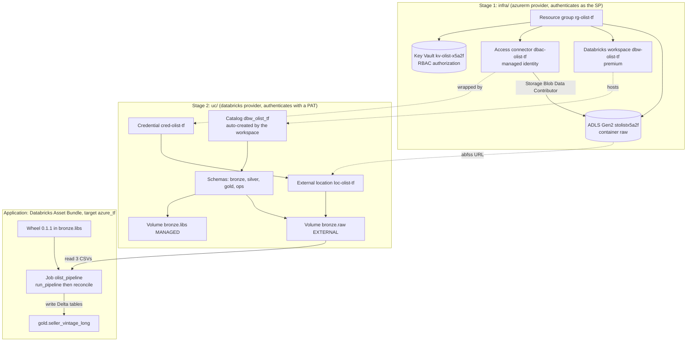
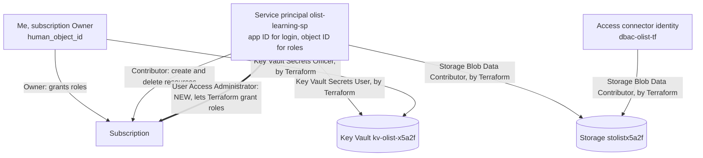
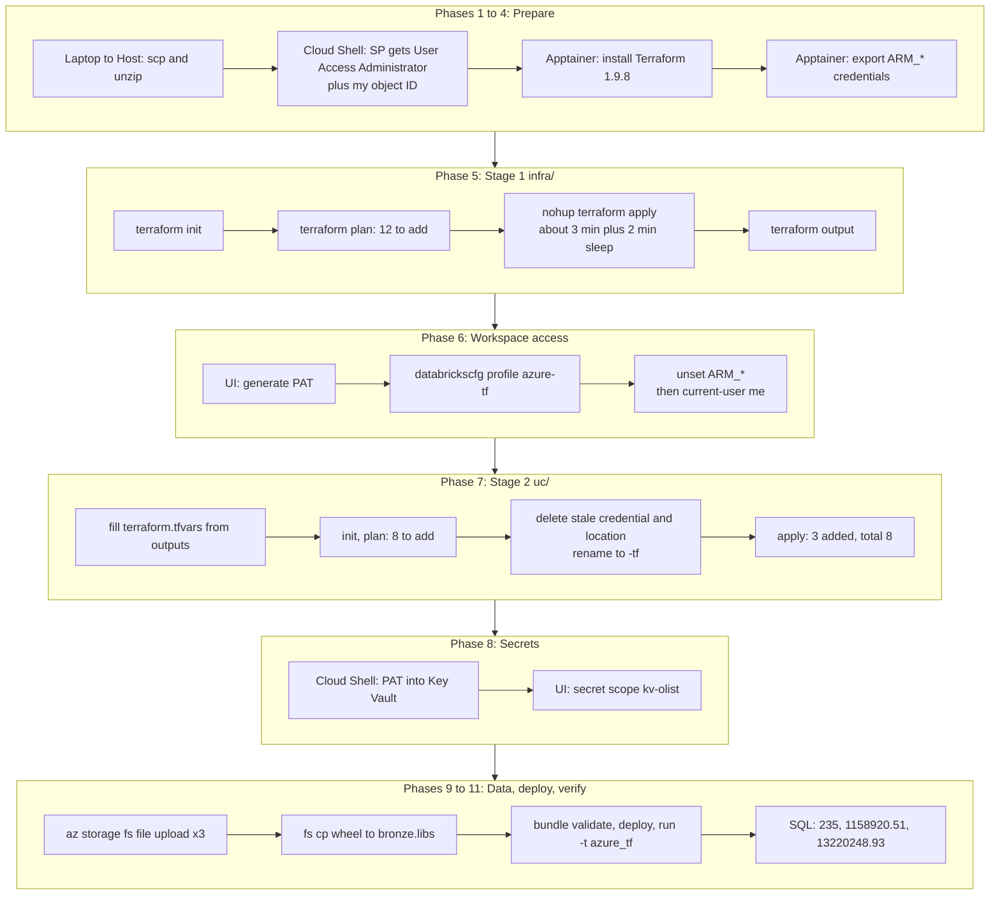
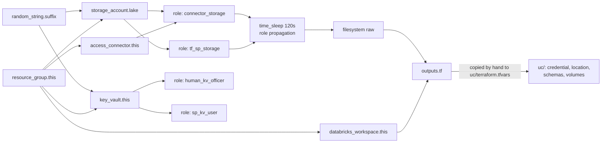

# Azure Databricks lakehouse with Terraform: rebuild, deploy and run

This covers:
- Rebuilding the hand-made Azure environment (resource group, ADLS Gen2, Key Vault, workspace, access connector, Unity Catalog wiring) as **Terraform code**, in two stages.
- The identity and permission model that connects the pieces, and what had to change for Terraform to work.
- Deploying and running the same `olist-vintage-lakehouse` bundle against the new workspace.

The pipeline logic did not change. What changed is **how the infrastructure is created**: from a list of typed commands and portal clicks to `terraform plan` and `terraform apply`.

> Replace `<PLACEHOLDER>` values with your own IDs. Subscription, tenant and object IDs are not secrets, but keep them out of public repos. **Never commit passwords, service principal secrets, Databricks tokens (PATs), `terraform.tfvars` or `*.tfstate`.**

---

## 1. Goal

- Turn the manual build (`rg-olist-learning`) into repeatable code (`rg-olist-tf`) that can be created and destroyed with two commands per stage.
- Learn what Terraform adds over the Azure CLI: a **plan** before every change, a **state file** that remembers what exists, and a **dependency graph** that orders the work.
- Prove equivalence: the Terraform-built environment must reproduce the hand-built results exactly (235 rows, 1158920.51 late, 13220248.93 total).

---

## 2. Architecture overview

Terraform is split in two stages because the second one needs a running workspace.



Terraform creates everything in the two top boxes. The bundle in the bottom box is unchanged apart from one new target in `databricks.yml`.

---

## 3. Who runs what

| Where | Runs as | Used for | Why |
|---|---|---|---|
| **[Laptop]** | me | Downloading the project zip, `scp` to the HPC | The HPC has no browser |
| **[Host]** (HPC login node) | me (Linux user) | Unzipping, starting the container | Outside Apptainer |
| **[A]** Apptainer terminal | the service principal (SP) for Azure and Terraform, a PAT for Databricks | `terraform`, `az storage`, `databricks` CLI | The container is the standard toolbox; `az login` as a human is blocked by MFA |
| **[Cloud Shell]** | me (subscription Owner) | Granting the SP its new role, reading my object ID, storing the PAT in Key Vault | The SP cannot grant roles (see Issue 1) |
| **[UI]** Azure portal and Databricks workspace | me | Opening the workspace, creating the PAT, creating the secret scope | Interactive steps |

Rule of thumb: **Terraform in Apptainer (SP) creates and uses resources. Cloud Shell (me) grants the powers the SP lacks.**

---

## 4. Variables and names

`~/.dataeng-config/olist.env` (host, mode `600`, no secrets), loaded inside the container with `source /cfg/olist.env`. It is the same file used by the hand-built setup:

```bash
export SUF=13440
export SA=stolist13440          # OLD storage account (hand-built)
export RG=rg-olist-learning     # OLD resource group
export KV=kv-olist-13440        # OLD Key Vault
export SP=<SP_APP_ID>
export SUB=<SUBSCRIPTION_ID>
export TENANT=<TENANT_ID>
export D=/path/to/SQL-PySpark/datasets/EXTRACTED/brazilian-ecommerce
```

Careful: `SA`, `RG` and `KV` still point to the **old** build. The new names come from Terraform outputs, so step 9 sets `SA` again.

| Variable | Meaning |
|---|---|
| `ARM_CLIENT_ID`, `ARM_TENANT_ID`, `ARM_SUBSCRIPTION_ID`, `ARM_CLIENT_SECRET` | What the `azurerm` provider reads to log in as the SP. Set for Terraform, **unset before using the Databricks CLI** |
| `human_object_id` | Terraform variable in `infra/terraform.tfvars`: my user's object ID, used to give me Key Vault Secrets Officer |
| `skip_validation` | Optional Terraform variable in `uc/`: skips the external location's storage checks. Not needed in our run |

### Databricks CLI profiles (`~/.dataeng-config/databricks/databrickscfg`)

| Profile | Workspace | Notes |
|---|---|---|
| `DEFAULT` | Free Edition | Default. Commands without `-p` go here |
| `azure` | Hand-built Azure workspace (`dbw-olist-learning`) | Still used to clean up old Unity Catalog objects |
| `azure-tf` | **New** Terraform workspace (`dbw-olist-tf`) | Added in step 6 |

---

## 5. Resource inventory

### Stage 1, `infra/`: 12 Azure objects, region `eastus2`

| Terraform address | Name | Purpose |
|---|---|---|
| `random_string.suffix` | `x5a2f` | Makes globally unique names (storage, vault) |
| `azurerm_resource_group.this` | `rg-olist-tf` | Container; destroying it is the cleanup |
| `azurerm_storage_account.lake` | `stolistx5a2f` | ADLS Gen2, HNS on, TLS 1.2, **shared-key access off** |
| `azurerm_storage_data_lake_gen2_filesystem.containers["raw"]` | `raw` | Container for the 3 CSVs |
| `azurerm_databricks_workspace.this` | `dbw-olist-tf` | Premium workspace, Unity Catalog on |
| `azurerm_databricks_access_connector.this` | `dbac-olist-tf` | System-assigned identity for storage access |
| `azurerm_key_vault.this` | `kv-olist-x5a2f` | Secret store, RBAC authorization |
| `azurerm_role_assignment.connector_storage` | connector, Storage Blob Data Contributor | Databricks reads and writes the lake |
| `azurerm_role_assignment.tf_sp_storage` | SP, Storage Blob Data Contributor | The SP can upload the CSVs |
| `azurerm_role_assignment.human_kv_officer` | me, Key Vault Secrets Officer | I can write secrets |
| `azurerm_role_assignment.sp_kv_user` | SP, Key Vault Secrets User | The SP can read secrets |
| `time_sleep.rbac_propagation` | 120 s | Waits for role assignments to take effect |

Plus an auto-created managed resource group `databricks-rg-dbw-olist-tf-managed`. Do not modify it.

### Stage 2, `uc/`: 8 Unity Catalog objects

```
metastore (shared by workspaces in eastus2)
├─ storage credential  cred-olist-tf      -> access connector dbac-olist-tf
├─ external location   loc-olist-tf       -> abfss://raw@stolistx5a2f.dfs.core.windows.net/
└─ catalog dbw_olist_tf                   (auto-created by the workspace)
   ├─ schema bronze
   │   ├─ volume raw   (EXTERNAL) -> abfss://raw@stolistx5a2f.dfs.core.windows.net/
   │   └─ volume libs  (MANAGED)  -> holds the wheel
   ├─ schema silver
   ├─ schema gold   -> seller_vintage_long (created by the job)
   └─ schema ops
```

### Old versus new

| | Hand-built | Terraform |
|---|---|---|
| Resource group | `rg-olist-learning` | `rg-olist-tf` |
| Storage | `stolist13440` | `stolistx5a2f` |
| Key Vault | `kv-olist-13440` | `kv-olist-x5a2f` |
| Workspace | `dbw-olist-learning` | `dbw-olist-tf` |
| Catalog | `dbw_olist_learning` | `dbw_olist_tf` |
| UC credential / location | `cred-olist` / `loc-olist-raw` | `cred-olist-tf` / `loc-olist-tf` |
| CLI profile / bundle target | `azure` / `azure` | `azure-tf` / `azure_tf` |

---

## 6. Identities and permissions



| Identity | Role | Scope | Allows |
|---|---|---|---|
| Me | Owner | Subscription | Everything, including granting roles |
| Service principal | Contributor | Subscription | Create and delete resources (control plane) |
| Service principal | **User Access Administrator** (new) | Subscription | Create role assignments, which Terraform does 4 times in stage 1 |
| Service principal | Storage Blob Data Contributor | Storage account | Read and write blobs (data plane), granted by Terraform |
| Service principal | Key Vault Secrets User | Key Vault | Read secrets only, granted by Terraform |
| Me | Key Vault Secrets Officer | Key Vault | Read and write secrets, granted by Terraform |
| Access connector identity | Storage Blob Data Contributor | Storage account | Databricks reads and writes the lake, granted by Terraform |

Key concept, **control plane vs data plane**: Contributor manages *resources* but cannot grant roles. The extra role in the table is exactly the gap that blocked the first attempt (Issue 1).

---

## 7. Setup workflow, step by step



### Phase 1: Get the project onto the HPC

**[Laptop]** download `olist-terraform.zip`, then copy it:

```bash
scp olist-terraform.zip <user>@<notchpeak-login-host>:~/GIT/Azure-Databricks/
```

**[Host]**

```bash
cd ~/GIT/Azure-Databricks
unzip olist-terraform.zip && ls olist-terraform
```

In our run the folder ended up inside the project, at `projects/olist-vintage-lakehouse/olist-terraform/`. Both layouts work; just `cd` to wherever `infra/` and `uc/` are.

```
olist-terraform/
├── infra/        stage 1: Azure resources
├── uc/           stage 2: Unity Catalog objects
└── RUNBOOK.md
```

### Phase 2: Let the SP create role assignments

The first attempt, run **[A]** as the SP, is refused:

```bash
az role assignment create --assignee $SP --role "User Access Administrator" --scope /subscriptions/$SUB
(AuthorizationFailed) The client '<SP_APP_ID>' with object id '<SP_OBJECT_ID>' does not have authorization
to perform action 'Microsoft.Authorization/roleAssignments/write' over scope '/subscriptions/<SUB>/...'
```

The SP only has Contributor, so it cannot grant itself (or anyone) roles. The same command works as the Owner.

**[Cloud Shell]**

```bash
SP=<SP_APP_ID>
SUB=<SUBSCRIPTION_ID>
az role assignment create --assignee $SP --role "User Access Administrator" --scope /subscriptions/$SUB
{
  "principalId": "<SP_OBJECT_ID>",
  "principalType": "ServicePrincipal",
  "roleDefinitionId": ".../roleDefinitions/18d7d88d-d35e-4fb5-a5c3-7773c20a72d9",
  "scope": "/subscriptions/<SUB>",
  "updatedBy": "<MY_OBJECT_ID>"
}

az ad signed-in-user show --query id -o tsv
<MY_OBJECT_ID>          # copy this: it is human_object_id
```

### Phase 3: Install Terraform in the container

**[A]** The container has no Terraform, so the binary goes into the persisted config folder:

```bash
source /cfg/olist.env
cd /tmp   # any scratch folder works
curl -sSLo tf.zip https://releases.hashicorp.com/terraform/1.9.8/terraform_1.9.8_linux_amd64.zip
unzip -o tf.zip -d ~/.dataeng-config/bin
Archive:  tf.zip
  inflating: /home/<user>/.dataeng-config/bin/LICENSE.txt
  inflating: /home/<user>/.dataeng-config/bin/terraform

chmod +x ~/.dataeng-config/bin/terraform
export PATH=$HOME/.dataeng-config/bin:$PATH
terraform version
Terraform v1.9.8
on linux_amd64

Your version of Terraform is out of date! The latest version is 1.17.1.
```

The "out of date" notice is harmless. Only the `export PATH` line must be repeated in every new container session.

### Phase 4: Give Terraform the SP credentials

**[A]** Nothing is written to disk; the secret is read from a hidden prompt:

```bash
source /cfg/olist.env
export ARM_CLIENT_ID=$SP ARM_TENANT_ID=$TENANT ARM_SUBSCRIPTION_ID=$SUB
read -rsp "SP secret: " ARM_CLIENT_SECRET; echo; export ARM_CLIENT_SECRET
```

If you no longer have the secret, reset it in Cloud Shell with `az ad sp credential reset --id $SP`. It is printed once and replaces the old one.

### Phase 5: Stage 1, Azure resources (`infra/`)

**[A]**

```bash
cd ~/GIT/Azure-Databricks/olist-terraform/infra
ls
main.tf  outputs.tf  terraform.tfvars.example  variables.tf  versions.tf

cp terraform.tfvars.example terraform.tfvars
vim terraform.tfvars
cat terraform.tfvars
human_object_id = "<MY_OBJECT_ID>"
```

`init` downloads the providers and writes a lock file:

```bash
terraform init
- Installing hashicorp/random v3.9.1...
- Installing hashicorp/time v0.14.2...
- Installing hashicorp/azurerm v4.81.0...
Terraform has created a lock file .terraform.lock.hcl to record the provider selections it made above.
Terraform has been successfully initialized!
```

`plan -out` shows exactly what would happen and saves it, so `apply` performs that plan and nothing else:

```bash
terraform plan -out tf.plan
...
  # azurerm_storage_account.lake will be created
  + resource "azurerm_storage_account" "lake" {
      + is_hns_enabled                = true
      + min_tls_version               = "TLS1_2"
      + shared_access_key_enabled     = false
      ...
    }
  # time_sleep.rbac_propagation will be created
  + resource "time_sleep" "rbac_propagation" {
      + create_duration = "120s"
    }

Plan: 12 to add, 0 to change, 0 to destroy.
Saved the plan to: tf.plan
```

Apply in the background so a dropped SSH connection cannot interrupt it, and read the log:

```bash
nohup terraform apply tf.plan > terraform-apply.log 2>&1 &
cat terraform-apply.log
random_string.suffix: Creation complete after 0s [id=x5a2f]
azurerm_resource_group.this: Creation complete after 22s
azurerm_databricks_access_connector.this: Creation complete after 13s
azurerm_storage_account.lake: Creation complete after 1m16s
azurerm_role_assignment.tf_sp_storage: Creation complete after 27s
azurerm_role_assignment.connector_storage: Creation complete after 28s
time_sleep.rbac_propagation: Still creating... [1m40s elapsed]
azurerm_key_vault.this: Creation complete after 2m29s
azurerm_role_assignment.human_kv_officer: Creation complete after 28s
azurerm_role_assignment.sp_kv_user: Creation complete after 26s
azurerm_databricks_workspace.this: Creation complete after 3m15s
time_sleep.rbac_propagation: Creation complete after 2m0s
azurerm_storage_data_lake_gen2_filesystem.containers["raw"]: Creation complete after 2s

Apply complete! Resources: 12 added, 0 changed, 0 destroyed.
```

Note how the log shows the **parallel** creation (vault, workspace and storage all start together) and the **ordering** (the `raw` container waits for the 120 s sleep). The outputs are the hand-off to stage 2:

```bash
terraform output
access_connector_id  = "/subscriptions/<SUB>/resourceGroups/rg-olist-tf/providers/Microsoft.Databricks/accessConnectors/dbac-olist-tf"
catalog_name         = "dbw_olist_tf"
key_vault_id         = "/subscriptions/<SUB>/resourceGroups/rg-olist-tf/providers/Microsoft.KeyVault/vaults/kv-olist-x5a2f"
key_vault_name       = "kv-olist-x5a2f"
key_vault_uri        = "https://kv-olist-x5a2f.vault.azure.net/"
storage_account_name = "stolistx5a2f"
workspace_url        = "https://adb-<NEW_WORKSPACE_ID>.4.azuredatabricks.net"
```

### Phase 6: PAT and CLI profile for the new workspace

**[UI]** Azure portal, Resource groups, `rg-olist-tf`, `dbw-olist-tf`, **Launch workspace**. Then Profile, Settings, Developer, Access tokens, **Generate new token**.

**[A]** Add a third profile:

```ini
[azure-tf]
host  = https://adb-<NEW_WORKSPACE_ID>.4.azuredatabricks.net
token = <NEW_PAT>
```

The first CLI call fails or complains while the `ARM_*` variables are still exported: the Databricks CLI also reads them as Azure service-principal credentials, so with a PAT in the profile it sees **two** auth methods and refuses to pick one (Issue 2). Remove them first:

```bash
unset ARM_CLIENT_ID ARM_CLIENT_SECRET ARM_TENANT_ID ARM_SUBSCRIPTION_ID

databricks -p azure-tf current-user me
{
  "active": true,
  "displayName": "<my name>",
  "groups": [ { "display": "admins" }, { "display": "users" } ],
  "userName": "<my email>"
}

databricks -p azure-tf catalogs list
Name           Type             Comment
system         SYSTEM_CATALOG   System catalog (auto-created)
samples        SYSTEM_CATALOG   These sample datasets are made available by third party data providers ...
dbw_olist_tf   MANAGED_CATALOG
```

The workspace auto-created the catalog `dbw_olist_tf`, matching Terraform's `catalog_name` output. Re-export the `ARM_*` variables (phase 4) whenever you go back to Terraform in `infra/`.

### Phase 7: Stage 2, Unity Catalog objects (`uc/`)

**[A]** Fill the five values from the stage 1 output:

```bash
cd ~/GIT/Azure-Databricks/olist-terraform/uc
cp terraform.tfvars.example terraform.tfvars
cat terraform.tfvars
catalog_name         = "dbw_olist_tf"
storage_account_name = "stolistx5a2f"
access_connector_id  = "/subscriptions/<SUB>/resourceGroups/rg-olist-tf/providers/Microsoft.Databricks/accessConnectors/dbac-olist-tf"
key_vault_id         = "/subscriptions/<SUB>/resourceGroups/rg-olist-tf/providers/Microsoft.KeyVault/vaults/kv-olist-x5a2f"
key_vault_uri        = "https://kv-olist-x5a2f.vault.azure.net/"

terraform init
- Installing databricks/databricks v1.141.0...
Terraform has been successfully initialized!

terraform plan
...
Plan: 8 to add, 0 to change, 0 to destroy.
```

The eight objects: one credential, one external location, four schemas, two volumes.

**What went wrong here.** Unity Catalog credentials and external locations belong to the **metastore**, which is shared by every workspace in the region. They are not inside the resource group, so they outlive `rg-olist-learning`. The hand-built `cred-olist` and `loc-olist-raw` were still registered and pointed at the old access connector. A first apply created what did not depend on them (the schemas and the `libs` volume) and stopped at the credential and location. The fix has three parts:

1. Delete the stale pair using the **old** profile (they belong to the old workspace's connector):

```bash
databricks -p azure external-locations delete loc-olist-raw --force
databricks -p azure storage-credentials delete cred-olist --force
```

2. Rename the new ones in `uc/` to `cred-olist-tf` and `loc-olist-tf`, so the two builds can never collide again.

3. Re-run. Terraform refreshes the state, sees the schemas and `libs` already exist, and creates only the rest:

```bash
terraform apply
databricks_schema.layers["silver"]: Refreshing state... [id=dbw_olist_tf.silver]
databricks_schema.layers["bronze"]: Refreshing state... [id=dbw_olist_tf.bronze]
databricks_volume.libs: Refreshing state... [id=dbw_olist_tf.bronze.libs]
...
Plan: 3 to add, 0 to change, 0 to destroy.

  Enter a value: yes

databricks_storage_credential.olist: Creation complete after 1s [id=cred-olist-tf]
databricks_external_location.raw: Creation complete after 2s [id=loc-olist-tf]
databricks_volume.raw: Creation complete after 1s [id=dbw_olist_tf.bronze.raw]
Apply complete! Resources: 3 added, 0 changed, 0 destroyed.
```

This is the clearest demonstration of why state matters: Terraform resumed from where it stopped instead of failing on the things that already existed. The external location's own storage checks (read, write, list, hierarchical namespace) passed on this run; if they ever fail on file-events, `terraform apply -var skip_validation=true` is the fallback.

### Phase 8: Token in Key Vault and the secret scope

> This phase is in `RUNBOOK.md` but is **not visible in the terminal session we reproduced from**, so treat the output as unverified.

**[Cloud Shell]** (my user holds Secrets Officer on the new vault, granted by Terraform):

```bash
read -rsp "PAT: " PAT; echo
az keyvault secret set --vault-name kv-olist-x5a2f -n databricks-token --value "$PAT" >/dev/null
unset PAT
```

**[UI]** Open `https://adb-<NEW_WORKSPACE_ID>.4.azuredatabricks.net#secrets/createScope` and fill in:

| Field | Value |
|---|---|
| Scope name | `kv-olist` |
| DNS name | `https://kv-olist-x5a2f.vault.azure.net/` (`key_vault_uri`) |
| Resource ID | `key_vault_id` from the stage 1 output |

### Phase 9: Upload the data

**[A]** `SA` in `olist.env` still names the **old** account, so set the new one first, and use `--auth-mode login` because shared-key access is off:

```bash
source /cfg/olist.env
SA=stolistx5a2f
for f in olist_orders_dataset.csv olist_order_items_dataset.csv olist_sellers_dataset.csv; do
  az storage fs file upload -f raw -p $f --source $D/$f --account-name $SA --auth-mode login --overwrite true
done
{
  "content_length": 0,
  "etag": "\"0x8DF39D67CE6D16C\"",
  "last_modified": "2026-11-03T18:15:49+00:00",
  "request_server_encrypted": false,
  "version": "2026-04-06"
}
...(one block per file)

databricks -p azure-tf fs ls dbfs:/Volumes/dbw_olist_tf/bronze/raw/
olist_order_items_dataset.csv
olist_orders_dataset.csv
olist_sellers_dataset.csv
```

The upload goes **to storage through Azure**, and the listing reads **through the Unity Catalog volume**. Seeing the files there proves the whole chain: access connector, credential, external location, external volume.

### Phase 10: Wheel, bundle target, deploy and run

**[A]**

```bash
cd ~/GIT/Azure-Databricks/projects/olist-vintage-lakehouse
databricks -p azure-tf fs cp dist/olist_vintage_lakehouse-0.1.1-py3-none-any.whl \
  dbfs:/Volumes/dbw_olist_tf/bronze/libs/ --overwrite
dist/olist_vintage_lakehouse-0.1.1-py3-none-any.whl -> dbfs:/Volumes/dbw_olist_tf/bronze/libs/olist_vintage_lakehouse-0.1.1-py3-none-any.whl
```

Add a fourth target to `databricks.yml`; the other targets keep working untouched:

```yaml
targets:
  dev:
    mode: development
    default: true
    workspace:
      host: https://dbc-5f27b5b2-72da.cloud.databricks.com

  azure:
    mode: development
    workspace:
      host: https://adb-<OLD_WORKSPACE_ID>.4.azuredatabricks.net
    variables:
      catalog: dbw_olist_learning
      raw_path: /Volumes/dbw_olist_learning/bronze/raw

  azure_tf:
    mode: development
    workspace:
      host: https://adb-<NEW_WORKSPACE_ID>.4.azuredatabricks.net
    variables:
      catalog: dbw_olist_tf
      raw_path: /Volumes/dbw_olist_tf/bronze/raw
```

```bash
databricks -p azure-tf bundle validate -t azure_tf
Name: olist-vintage-lakehouse
Target: azure_tf
Workspace:
  Host: https://adb-<NEW_WORKSPACE_ID>.4.azuredatabricks.net
  User: <my email>
  Path: /Workspace/Users/<my email>/.bundle/olist-vintage-lakehouse/azure_tf
Validation OK!

databricks -p azure-tf bundle deploy -t azure_tf
Uploading bundle files to /Workspace/Users/<my email>/.bundle/olist-vintage-lakehouse/azure_tf/files...
Created jobs.olist_pipeline
Files: 38 uploaded, 0 deleted
Resources: 1 created, 0 changed, 0 deleted, 0 unchanged

databricks -p azure-tf bundle run -t azure_tf olist_pipeline --params fechaproceso=2018-08-31
Run URL: https://adb-<NEW_WORKSPACE_ID>.4.azuredatabricks.net/jobs/<JOB_ID>/runs/<RUN_ID>?o=<NEW_WORKSPACE_ID>
2026-11-03 11:20:54 "[dev <user>] olist_pipeline" RUNNING
2026-11-03 11:23:22 "[dev <user>] olist_pipeline" TERMINATED SUCCESS
```

The job has two tasks, `run_pipeline` and `reconcile`, so `TERMINATED SUCCESS` means both passed. The run took about 2.5 minutes on serverless compute.

### Phase 11: Verify

```bash
databricks -p azure-tf warehouses list
ID                Name                          Size   State
<WAREHOUSE_ID>    Serverless Starter Warehouse  Small  STOPPED

databricks -p azure-tf api post /api/2.0/sql/statements --json '{
  "warehouse_id": "<WAREHOUSE_ID>",
  "statement": "SELECT count(*) n, sum(late_amount) late, sum(total_amount) total FROM dbw_olist_tf.gold.seller_vintage_long",
  "wait_timeout": "30s"
}' | grep -A8 data_array
    "data_array": [
      [
        "235",
        "1158920.51",
        "13220248.93"
      ]
    ]
```

The warehouse was `STOPPED` and started itself for the query (serverless). Its ID is different from the old workspace's, so do not reuse the old one.

### Phase 12: Retire the hand-built copy (pending)

Only after phase 11 matches, which it now does. This step has **not** been run yet.

**[A]**

```bash
az group delete -n rg-olist-learning --yes --no-wait
# once it finishes: free the soft-deleted vault name
az keyvault purge -n kv-olist-13440
```

The old workspace, access connector and storage go with the group. **Keep the SP**, because Terraform uses it. The stale Unity Catalog objects were already removed in phase 7.

---

## 8. Terraform dependency graph

Terraform works out the order itself from references between resources.



Everything on the same level runs in parallel (the vault, workspace and storage account all started within the same second). The `time_sleep` exists because a new Azure role assignment can take a minute or two to become effective: without it, creating the `raw` container right after granting the SP access fails intermittently.

---

## 9. Results

| Check | Hand-built Azure (`dbw_olist_learning`) | Terraform (`dbw_olist_tf`) |
|---|---|---|
| Gold rows (`seller_vintage_long`) | 235 | 235 |
| Late amount sum | 1,158,920.51 | 1,158,920.51 |
| Total amount sum | 13,220,248.93 | 13,220,248.93 |
| Job `olist_pipeline` (incl. `reconcile` task) | SUCCESS | SUCCESS |

The row-level `xxhash64` fingerprint (101643891411089654003 in the earlier runs) was not queried again in this session. The `reconcile` task that compares the SQL and PySpark gold tables is part of the job and passed.

Findings:

- **Same code, new environment, identical numbers.** Only storage, identity and deployment changed.
- **Most problems were about identity, not resources.** Contributor vs. role-granting rights, SP vs. PAT authentication, metastore-level vs. resource-group-level objects.
- **Two stages are the right split.** The `databricks` provider needs a running workspace and a PAT, which only exist after stage 1.
- **Reruns are safe.** `apply` resumed cleanly after a partial stage 2.
- **State is the memory.** Delete `terraform.tfstate` and Terraform no longer knows what it built.

---

## 10. Design decisions

- **Two stacks, `infra/` and `uc/`.** Different providers, different credentials, different lifecycles. `uc/` destroys first.
- **Same SP as before.** Terraform reuses `olist-learning-sp`; the only change is one added role.
- **Entra-only storage access.** `shared_access_key_enabled = false`, so every call is identity plus RBAC and is auditable. This is why uploads use `--auth-mode login`.
- **Managed identity (access connector) for Databricks to storage.** No keys, no rotation.
- **RBAC Key Vault with separate read and write roles.** Least privilege.
- **Random suffix instead of a hand-picked number.** Globally unique names without collisions.
- **`time_sleep` for role propagation.** A deliberate 120 s that removes a flaky failure.
- **Separate `-tf` names for the Unity Catalog objects.** Old and new builds cannot clash in the shared metastore.
- **Plan saved to a file.** `apply tf.plan` executes exactly what was reviewed.
- **Background apply with `nohup`.** The workspace takes about 3 minutes and the sleep 2 more; a disconnect should not kill it.

---

## 11. Known limitations and open items

- **Secret scope step unverified.** Phase 8 is in the runbook but not in the captured session. The job succeeded, but we did not confirm that anything reads the scope.
- **State is local.** `terraform.tfstate` lives on the HPC filesystem. Lose it and Terraform forgets the resources. A real setup would use a remote backend (e.g. an Azure storage container with locking).
- **Broad SP rights.** The SP now holds Contributor **and** User Access Administrator on the whole subscription. Acceptable for a learning subscription; in real use, scope it to the resource group or remove the role after the build.
- **Tokens and secrets were exposed in terminal output.** The SP secret and the PATs were visible in the captured session. Rotate the secret (`az ad sp credential reset --id $SP`) and regenerate the PATs. Never reuse that session text publicly.
- **PAT in a plain-text config file.** Fine for a sandbox; a real deployment would use OAuth or an SP for Databricks authentication.
- **Outputs are copied by hand** from `infra/` to `uc/terraform.tfvars`. A remote-state data source or a single root module could remove that step.
- **File events skipped.** Not needed for 3 files; enabling them requires extra roles on the connector and the `Microsoft.EventGrid` provider.
- **Old build not yet retired.** Phase 12 is pending.
- **Trial limits.** Credit and the 30-day window expire; resources are disabled afterwards unless the subscription is upgraded.

---

## 12. Cost control and teardown

- Set a budget alert (Cost Management, Budgets, e.g. $10 with an email at 80%).
- Confirm the SQL warehouse auto-stops: `databricks -p azure-tf warehouses get <WAREHOUSE_ID>`.

Teardown, **in this order** (stage 2 depends on stage 1):

```bash
# [A] with ARM_* exported for infra/, and the azure-tf profile valid for uc/
cd ~/GIT/Azure-Databricks/olist-terraform/uc     && terraform destroy
cd ../infra                                      && terraform destroy
```

Keep both `terraform.tfstate` files until the destroys finish. Afterwards, free the vault name if needed and revoke tokens:

```bash
az keyvault purge -n kv-olist-x5a2f        # only if the vault name is soft-deleted and you want to reuse it
```

`.gitignore` for `olist-terraform/`:

```
.terraform/
*.tfstate
*.tfstate.*
terraform.tfvars
tf.plan
terraform-apply.log
session.log*
```

Commit `.terraform.lock.hcl` so provider versions stay pinned.

---

## 13. Troubleshooting log (errors actually hit)

| Symptom | Cause | Fix |
|---|---|---|
| `AuthorizationFailed ... roleAssignments/write` when granting User Access Administrator from the container | The SP has Contributor only, which cannot write role assignments | Run the grant in Cloud Shell as the Owner (phase 2) |
| Databricks CLI will not choose an auth method | `ARM_CLIENT_ID`, `ARM_CLIENT_SECRET`, `ARM_TENANT_ID` (exported for Terraform) plus a PAT in the profile count as two methods | `unset ARM_CLIENT_ID ARM_CLIENT_SECRET ARM_TENANT_ID ARM_SUBSCRIPTION_ID` before any `databricks` command |
| `uc/` apply stalls on credential and external location | The old `cred-olist` and `loc-olist-raw` live in the shared metastore and outlived the old resource group | Delete them with `-p azure ... --force`, rename new ones to `-tf`, re-apply |
| Plan says 12 resources, runbook says about 13 | The runbook figure was an estimate | None; 12 is correct |
| Upload errors with an auth failure | Shared-key access is off, so account keys are not accepted | Use `--auth-mode login`; the SP needs Storage Blob Data Contributor and a few minutes to propagate |
| Upload goes to the wrong storage account | `SA` in `olist.env` still names the old account | Set `SA=stolistx5a2f` (or the current output) before the loop |
| Terraform "out of date" notice | Pinned to 1.9.8 on purpose | None needed |
| Long apply killed by a disconnect | Interactive terminal | `nohup terraform apply tf.plan > terraform-apply.log 2>&1 &` |

---

## 14. Vocabulary

| Term | Meaning |
|---|---|
| **Terraform** | Tool that creates cloud resources from declarative `.tf` files |
| **Infrastructure as code (IaC)** | Describing infrastructure in versioned files instead of clicking or typing one-off commands |
| **Provider** | Plugin that lets Terraform talk to a platform (`azurerm`, `databricks`, `random`, `time`) |
| **Resource / data source** | A thing Terraform creates / a thing it only reads (e.g. `data.azurerm_client_config`) |
| **Module / root module** | A folder of `.tf` files. Here `infra/` and `uc/` are two independent root modules |
| **Variable / `terraform.tfvars`** | An input parameter / the file that supplies values. Holds IDs, never commit it |
| **Output** | A value Terraform prints after apply, used to feed the next stage |
| **State (`terraform.tfstate`)** | Terraform's record of what it built. Required for updates and destroy |
| **Plan / apply / destroy** | Preview changes / execute them / remove everything |
| **`.terraform.lock.hcl`** | Pins provider versions. Commit it |
| **`time_sleep`** | Resource that just waits, used to cover Azure's role propagation delay |
| **`random_string`** | Resource that generates a stable random value, used for unique names |
| **Azure subscription** | Billing and quota boundary containing all resources |
| **Microsoft Entra ID (tenant)** | Azure's identity directory |
| **Resource group (RG)** | Container for related resources. Deleting it deletes everything inside |
| **Service principal (SP)** | Non-human identity for automation |
| **Application (client) ID / object ID** | The SP's login name / its unique ID used in role assignments and errors |
| **Managed identity** | Identity owned by an Azure resource, with no secret to manage |
| **Access connector** | Azure resource carrying a managed identity that Unity Catalog uses to reach storage |
| **RBAC / role assignment / scope** | Permission model: a role granted to an identity at a scope |
| **Control plane / data plane** | Managing resources / accessing the data inside them |
| **Contributor / Owner / User Access Administrator** | Control-plane roles. Only the last two can grant roles |
| **Storage Blob Data Contributor** | Data-plane role to read, write and delete blobs |
| **Key Vault Secrets Officer / User** | Data-plane roles for secrets: read and write / read only |
| **Role propagation** | The delay (minutes) before a new role takes effect |
| **ADLS Gen2 / HNS** | Blob storage with hierarchical namespace (real directories). Set at creation only |
| **`abfss://`** | URI scheme for ADLS Gen2: `abfss://<container>@<account>.dfs.core.windows.net/<path>` |
| **Shared key** | Account-wide access key. Disabled so only Entra identity works |
| **Key Vault / soft delete / purge** | Managed secret store / deleted vaults stay recoverable / purge frees the name |
| **Azure Databricks workspace (premium)** | The Databricks environment in Azure. Premium is needed for Unity Catalog features |
| **Unity Catalog (UC) / metastore** | Databricks governance layer / the region-wide store of its metadata, shared by workspaces |
| **Catalog / schema** | UC namespaces: `catalog.schema.table` |
| **Storage credential / external location** | UC objects: an identity that can reach storage / a path bound to that credential |
| **Volume (external / managed)** | UC-governed file path under `/Volumes/...` over your storage / over managed storage |
| **PAT** | Databricks personal access token. A bearer secret; treat like a password |
| **Secret scope** | Databricks container for secrets, here backed by Key Vault |
| **Databricks Asset Bundle / target** | YAML project that deploys jobs from the terminal / a named environment inside it |
| **Wheel (`.whl`)** | Built Python package installed by the job |
| **Serverless** | Databricks-managed compute that does not use your vCPU quota |
| **Medallion (bronze/silver/gold)** | Raw, cleaned, and business-ready data layers |
| **Reconcile** | Comparing two outputs by row count, sums and a hash |
| **Apptainer** | Container runtime used on the HPC (formerly Singularity) |
| **Cloud Shell** | Browser terminal in Azure, already signed in as you |
| **`nohup`** | Keeps a command running after you disconnect |

---

## 15. Commands reference

Legend for "Runs as": **SP** = Apptainer as service principal, **Me** = Cloud Shell as Owner, **PAT** = Databricks token profile.

### Terraform

| Command | What it does | Notes |
|---|---|---|
| `terraform version` | Prints the installed version | Confirms the PATH is set |
| `terraform init` | Downloads providers, creates `.terraform/` and the lock file | Run once per folder, again if providers change |
| `terraform plan` | Shows what would change | Changes nothing |
| `terraform plan -out tf.plan` | Same, and saves the plan | `apply tf.plan` then runs exactly this |
| `terraform apply tf.plan` | Executes a saved plan | Does not ask for confirmation |
| `terraform apply` | Plans and asks `yes` | Used in `uc/` |
| `terraform apply -var skip_validation=true` | Passes a variable on the command line | Fallback if the external location's checks fail |
| `nohup terraform apply tf.plan > terraform-apply.log 2>&1 &` | Runs in the background and logs to a file | Survives disconnects; read with `cat` or `tail -f` |
| `terraform output` | Prints the outputs | Feeds `uc/terraform.tfvars` |
| `terraform destroy` | Removes everything in the state | Run `uc/` first, then `infra/` |

### Azure CLI

| Command | What it does | Runs as / Notes |
|---|---|---|
| `az account show --query user -o json` | Shows who the CLI is logged in as | SP. Type `servicePrincipal` |
| `az account show --query "{user:user.name, tenant:tenantId, subscription:id}" -o table` | Shows user, tenant, subscription | SP |
| `az role assignment create --assignee <appId> --role "User Access Administrator" --scope /subscriptions/<id>` | Grants the SP role-granting rights | **Me only**; fails as the SP |
| `az ad signed-in-user show --query id -o tsv` | Prints my object ID | Me. This is `human_object_id` |
| `az ad sp credential reset --id <appId>` | Issues a new SP secret and invalidates the old one | Me. Printed once |
| `az storage fs file upload -f <container> -p <path> --source <local> --account-name <sa> --auth-mode login --overwrite true` | Uploads a file to the lake | SP. `-p` is the path inside the container |
| `az keyvault secret set --vault-name <kv> -n <name> --value "$PAT" >/dev/null` | Stores a secret | Me. Redirect output so the value is not printed |
| `az group delete -n <rg> --yes --no-wait` | Deletes the group and everything in it | SP. Irreversible |
| `az keyvault purge -n <kv>` | Frees a soft-deleted vault name | SP. Run after the group is gone |

### Databricks CLI

| Command | What it does | Notes |
|---|---|---|
| `databricks -p azure-tf current-user me` | Confirms profile, identity and workspace | First check after adding a profile |
| `databricks -p azure-tf catalogs list` | Lists catalogs | Shows `dbw_olist_tf` |
| `databricks -p azure external-locations delete <name> --force` | Removes a UC external location | Used on the **old** profile to clean up |
| `databricks -p azure storage-credentials delete <name> --force` | Removes a UC credential | Same |
| `databricks -p azure-tf fs ls dbfs:/Volumes/<cat>/<schema>/<vol>/` | Lists files in a volume | Proves the storage chain |
| `databricks -p azure-tf fs cp <local> dbfs:/Volumes/... --overwrite` | Copies a file into a volume | Used for the wheel |
| `databricks -p azure-tf bundle validate -t azure_tf` | Checks bundle config | Should end with `Validation OK!` |
| `databricks -p azure-tf bundle deploy -t azure_tf` | Uploads files, creates or updates the job | |
| `databricks -p azure-tf bundle run -t azure_tf olist_pipeline --params fechaproceso=2018-08-31` | Runs the job and waits | Prints the run URL and final state |
| `databricks -p azure-tf warehouses list` | Lists SQL warehouses | Gives the warehouse ID |
| `databricks -p azure-tf api post /api/2.0/sql/statements --json '{...}'` | Runs SQL through the REST API | `wait_timeout` makes it synchronous |

### Shell

| Command | What it does | Notes |
|---|---|---|
| `scp <file> <user>@<host>:<path>` | Copies a file to the HPC | Laptop |
| `unzip -o <zip> -d <dir>` | Extracts, overwriting | `python3 -m zipfile -e` if `unzip` is missing |
| `source /cfg/olist.env` | Loads shared variables in the container | Re-run each session |
| `export PATH=$HOME/.dataeng-config/bin:$PATH` | Makes `terraform` findable | Re-run each session |
| `read -rsp "prompt: " VAR; export VAR` | Reads a secret without echo or history | Used for `ARM_CLIENT_SECRET` and PATs |
| `unset ARM_CLIENT_ID ARM_CLIENT_SECRET ARM_TENANT_ID ARM_SUBSCRIPTION_ID` | Removes the Terraform credentials from the shell | Needed before Databricks CLI calls |